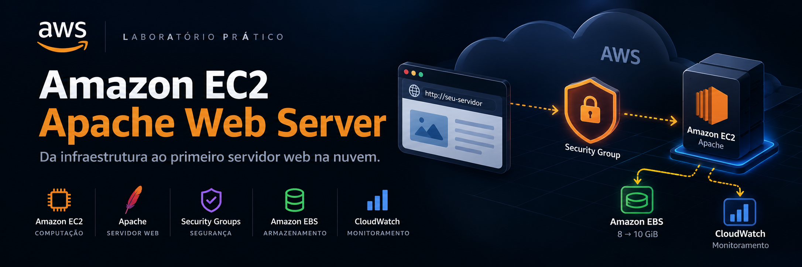
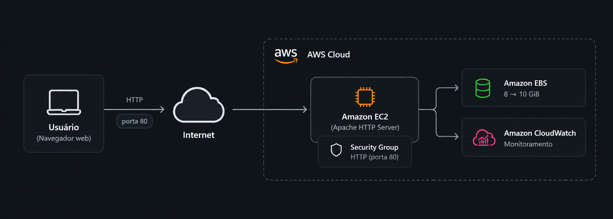

# ☁️ Amazon EC2 | Apache Web Server Lab

---

## 👋 Sobre o projeto

Sabe quando a gente começa a estudar uma tecnologia e
percebe que entender o motivo de cada configuração faz
toda a diferença?

Foi pensando nisso que decidi documentar este laboratório.

Aqui compartilho minha experiência com o Amazon EC2,
desde a criação de uma instância até a configuração
de um servidor web Apache.

E tem um diferencial: Preparei a documentação pensando
em dois públicos.

Quem está começando, assim como eu, vai encontrar aqui explicações mais simples, exemplos e um passo a passo para não ficar perdido no meio de tantos termos técnicos.

Já quem tem experiência na área pode explorar as configurações, os recursos utilizados e as decisões de infraestrutura.

**Um projeto, dois caminhos de aprendizado.**

---

## 🧭 Escolha por onde começar

### 🌱 Estou começando agora

Nunca trabalhou com AWS ou ainda está aprendendo
computação em nuvem?

Sem problema! Preparei um guia que explica os conceitos
e mostra o que acontece em cada etapa do laboratório.

**[📖 Acessar o guia para iniciantes](docs/guia-iniciantes.md)**

### 💻 Quero explorar a parte técnica

Já conhece os fundamentos e quer analisar a implementação?

Aqui você encontra as configurações da instância,
segurança, armazenamento, monitoramento e
redimensionamento.

**[📑 Acessar a documentação profissional](docs/guia-profissional.md)**

---

## 🏗️ Arquitetura do laboratório

O diagrama abaixo apresenta uma visão simplificada
da infraestrutura utilizada no laboratório.

**Fluxo:** o navegador envia uma requisição HTTP
pela porta 80 para a instância Amazon EC2.
O Security Group controla a permissão de entrada,
o Amazon EBS fornece armazenamento e o CloudWatch
disponibiliza métricas de monitoramento.

> Diagrama ilustrativo e simplificado do laboratório.

---

## ⚙️ Tecnologias e serviços utilizados

| Tecnologia | Aplicação no laboratório |
|---|---|
| Amazon EC2 | Servidor virtual na nuvem |
| Amazon Linux 2023 | Sistema operacional |
| Apache HTTP Server | Servidor web |
| Security Groups | Controle do tráfego de rede |
| Amazon EBS | Armazenamento da instância |
| Amazon CloudWatch | Monitoramento de métricas |
| User Data | Automação da configuração inicial |

---

## ✅ O que foi realizado

- [x] Criação de uma instância EC2 t3.micro
- [x] Instalação automatizada do Apache
- [x] Configuração do Security Group para HTTP
- [x] Acesso à página web pelo navegador
- [x] Monitoramento e verificações de status
- [x] Alteração da instância para t3.small
- [x] Expansão do volume EBS de 8 GiB para 10 GiB
- [x] Teste da proteção contra encerramento
- [x] Encerramento da instância

---

## 💡 O principal aprendizado

Criar um servidor não significa que ele estará
automaticamente acessível pela internet.

Durante o laboratório, o Apache estava configurado,
mas o acesso pelo navegador só funcionou depois
da liberação do tráfego HTTP no Security Group.

Essa experiência ajudou a demonstrar a importância
das configurações de rede e segurança na nuvem.

---

## 📌 Sobre este repositório

Este projeto nasceu de um laboratório educacional guiado, ministrado pelo professor Raphael Olsen, por meio do programa AWS re/Start da Escola da Nuvem.

O ambiente foi utilizado exclusivamente para fins de aprendizado e não representa uma infraestrutura de produção.

As configurações foram realizadas conforme os objetivos propostos pela atividade.

A documentação será aprimorada ao longo dos estudos, incluindo diagramas, exemplos e análises adicionais.

---

**Aprender, colocar em prática e compartilhar o conhecimento.** 🚀
